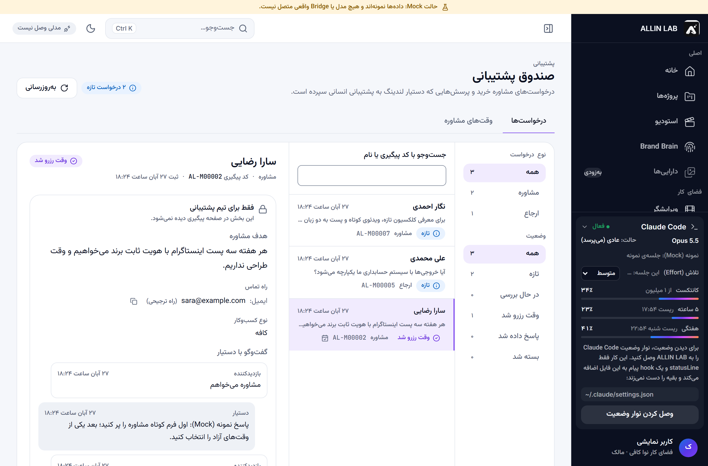
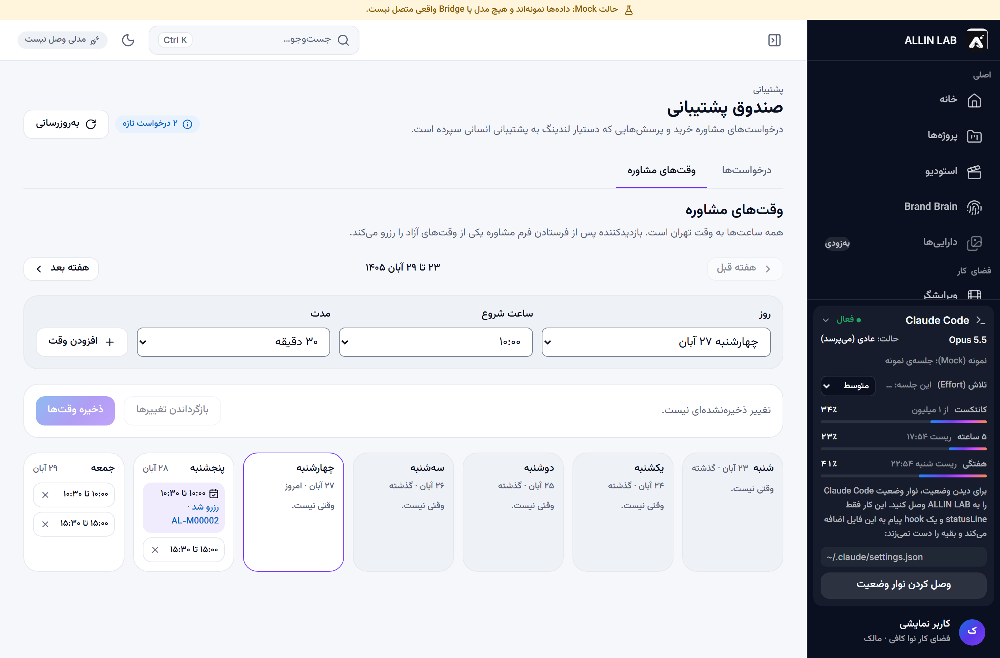
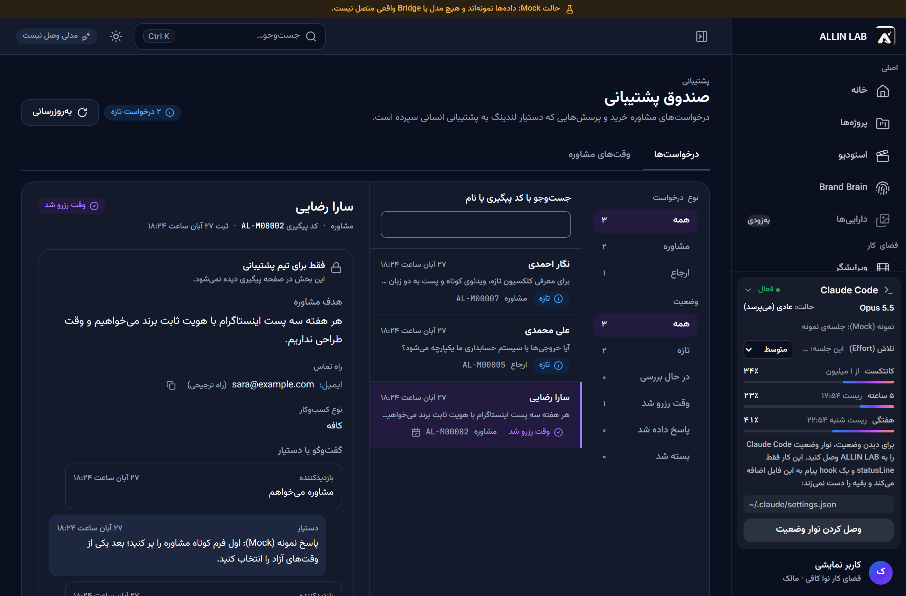
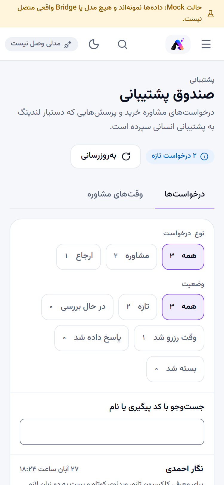

# ALLIN LAB: my part of a team AI content studio

**ALLIN LAB** is an AI content studio in Persian (right to left). A team of AI agents turns one brief into content for each format and channel, keeps the brand consistent across all of it, and a person approves the final result.

This repository shows my part of the project. The product's code is in the team's private repository, so there is no code here. You'll find what I built, how I tested it, and screenshots from the app's mock mode.

| | |
|---|---|
| **Team** | Seven people, each coding with Claude Code |
| **When** | October and November 2026, for a competition |
| **My role** | Developer, owner of two work packages |
| **Stack** | React, TypeScript, Vite, Tailwind CSS, Zod, MSW, Playwright, axe, Vitest |

## How the team worked

The work was split into small packages. Each package had one owner, its own folder and a written list of what "done" means. A shared API contract that nobody could change alone, plus a full mock of the server, let every package start on day one without waiting for the others. CI rejected any change outside the owner's folder. Each package was delivered as one commit in one pull request, and the integrator reviewed and merged it.

## 1. Accessibility and performance checks

**Status: merged.**

I built the test package that checks the whole app for accessibility and size, and wrote the team's report from its results.

| Check | Where | Runs |
|---|---|---|
| axe: WCAG 2.0 to 2.2, levels A and AA | 17 views, desktop (1366 px) and phone (375 px), light and dark themes | 68 |
| Keyboard: Tab reaches every control, and the focus is visible and not hidden | 17 views, desktop and phone | 34 |
| Reduced motion: nothing keeps moving | 17 views, desktop and phone | 34 |
| No sideways scrolling | 17 views at 360 px | 17 |
| Size of the JavaScript the app loads first | Production build | 1 |

**What it found**

- No critical problems. Six serious ones: low contrast on small text, button names that don't match their visible text, a mobile navigation bar that hid the focused control, and sideways scrolling on the settings page. All six were in other packages' code.
- Each problem became a GitHub issue with a clear owner. Its test is marked with the issue number and skipped only in the views where the problem appears, so the suite stays green and the problem stays on record until the fix lands.
- The whole app loaded as one 619 KB JavaScript file. After the fix, the first load is 14% smaller (162 KB gzipped), no file is over Vite's 500 KB warning, and the size budget runs as a normal test.

**How the report is made**

The report lists every problem in order of severity, with the page, the file and line that cause it, and who owns the fix. Its tables are generated from the raw results of the same test run, so every number comes from a run rather than being typed by hand.

## 2. Support inbox

**Status: delivered, pull request in review.**

The page where support staff answer consultation requests and the questions that the website's AI assistant hands to a person.

**What it does**

- Filters by request type and status, with a count for each, and search by tracking code or name.
- The detail view separates what only the support team sees (contact details, the goal, the chat with the assistant) from what the visitor sees on their tracking page (status, booking, replies), and the reply box says so.
- A reply to a new request marks it as answered, and the line under the button tells staff which status the reply will set.
- A weekly calendar of consultation times in Tehran time, with the week starting on Saturday. Staff add and remove times as a draft and save them together. Booked times can't be removed, and closing the tab with unsaved changes asks first.

**How it's built**

- The logic lives in two plain modules, one for filters, search and replies and one for the Tehran clock, the week and overlapping times. Both are tested apart from the interface.
- The selected request, the tab and the filters are kept in the page address, so a link opens the same view. The search text isn't kept there, because it could hold a phone number.
- Text from visitors and from the assistant is always shown as text, never run as HTML. A test checks this with an injected ``.
- A small hook gives the navigation menu the number of new requests. It refreshes when the inbox changes or the tab comes back into view, never on a timer, and it doesn't pull the inbox page into the app's first download.

**Testing**

- 29 Vitest tests for the filters, search, replies, status changes and consultation times.
- Checked with my accessibility suite: no serious axe problems in light and dark at both widths, keyboard on phone width, reduced motion, and no sideways scrolling at 360 px.

  
  

The screenshots come from the app's mock mode. The names, emails and phone number are made up.

---

The ALLIN LAB name, logo and product belong to the ALLIN LAB team.
